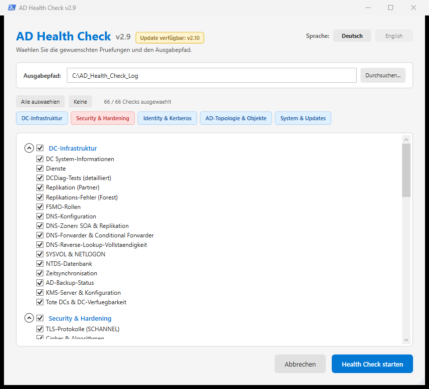

# 🛡️ Active Directory Health Check v2.13

[](https://docs.microsoft.com/en-us/powershell/)
[](https://www.microsoft.com/)
[](LICENSE)
[]()
[]()
[](https://gitlab.com/RoccoAmmon/Active-Directory-Health-Check/-/releases)

> 🇩🇪 [Deutsch](#-deutsch) | 🇬🇧 [English](#-english)

> Ein umfassendes PowerShell-Skript zur automatisierten Überprüfung der Gesundheit und Sicherheit einer Active Directory-Umgebung. Mit Best-Practice-Bewertung, farbcodiertem HTML-Report und CSV-Export.



> **DE:** Auswahlfenster der GUI: thematische Check-Gruppen, Suite-Buttons und frei wählbarer Ausgabepfad – hier bewusst mit einer **Testversion** (eine Version unter dem damals neuesten Release), damit das klickbare Badge „Update verfügbar: v2.10" neben der Versionsnummer sichtbar wird. Beim Start wird die GitLab-Releases-API geprüft (Timeout 3 s), ein Klick auf das Badge öffnet die Release-Seite; abschaltbar mit `-NoUpdateCheck`. Das Versions-Badge im Kopf dieser README zeigt weiterhin die echte Release-Version 2.13.
>
> **EN:** GUI selection window: thematic check groups, suite buttons and freely selectable output path – deliberately shown as a **test version** (one version below the then-latest release) so that the clickable badge “Update verfügbar: v2.10” (German UI) next to the version number becomes visible. On startup the GitLab releases API is queried (3 s timeout), clicking the badge opens the release page; can be disabled with `-NoUpdateCheck`. The version badge at the top of this README still shows the actual release version 2.13.

---

## 🇩🇪 Deutsch

### 📑 Inhaltsverzeichnis

- [Features](#-features)
- [Die 74 Checks](#-die-74-checks)
- [Systemanforderungen](#-systemanforderungen)
- [Installation](#-installation)
- [Verwendung](#-verwendung)
- [Sprache / Language](#-sprache--language)
- [Screenshots](#-screenshots)
- [Konfiguration](#-konfiguration)
- [Report-Ausgabe](#-report-ausgabe)
- [Architektur](#-architektur)
- [Troubleshooting](#-troubleshooting)
- [Contributing](#-contributing)
- [License](#-license)

---

### ✨ Features

- 🎯 **74 Best-Practice-Checks** thematisch sortiert (DC-Basis, Security, Struktur, Monitoring, Hybrid/Cloud) – inkl. Teilprüfung 55b (ADBA)
- 🖼️ **Moderne WPF-GUI** (Light Theme) mit Gruppen-Auswahl, Suite-Buttons und Ausgabepfad-Wahl
- 🎨 **Farbcodierter HTML-Report** mit Executive Dashboard (OK / WARN / KRITISCH / INFO)
- 📋 **Gesamtübersicht der Auffälligkeiten** – alle auffälligen Checks in einer Tabelle, nach Schwere sortiert, Befunde je Check gekürzt
- 📊 **CSV-Export** aller Check-Ergebnisse
- 🖥️ **Interaktives Startmenü** als Fallback für Konsolen-Betrieb
- ⚡ **Parameter-basierte Ausführung** für Scheduled Tasks / Automatisierung
- 🆕 **Update-Anzeige gegen GitLab-Releases** – beim Start wird das neueste Release geprüft (Timeout 3 s): klickbares Badge neben der Versionsnummer („Update verfügbar: v2.10"), in der Konsole/Skript eine Infozeile; unterdrückbar per `-NoUpdateCheck`
- 📁 **Frei wählbarer Ausgabepfad** per GUI oder `-OutputPath` Parameter
- 🔍 **DCDiag mit Einzeltest-Parsing** (DE/EN sprachunabhängig)
- 🔄 **Loopback-Erkennung** für lokale DCs (nutzt `localhost` statt FQDN)
- 📡 **Ping-Skip-Logik** für nicht erreichbare DCs mit Fallback auf WinRM
- 🌍 **Sprachunabhängig** via Well-Known SIDs
- 🗣️ **Automatische Spracherkennung & DE/EN-Sprachumschalter** – live umschaltbar in der WPF-GUI, überschreibbar per Parameter `-Language de|en`
- 📝 **Ausführliches Logging** (`C:\ScriptLog`)
- 🔧 **Modular aufgebaut** - einzelne Checks können gezielt ausgeführt werden

### 📋 Die 74 Checks

### 🏗️ DC-Basis-Infrastruktur
| # | Check | Beschreibung |
|---|---|---|
| 1 | **DC System-Informationen** | OS, RAM, Uptime, Hardware |
| 2 | **Dienste** | NTDS, DNS, Netlogon, KDC, W32Time, DFSR |
| 3 | **DCDiag-Tests** | Detailliertes Parsing aller DC-Diagnose-Tests |
| 4 | **Replikation (Partner)** | Status pro DC-Partner |
| 4b | **Replikations-Fehler (Forest)** | Forest-weite Replikationsprobleme |
| 5 | **FSMO-Rollen** | Alle 5 FSMO-Rolleninhaber |
| 6 | **DNS-Konfiguration** | Zonen, AD-Integration, Dynamic Updates |
| 7 | **SYSVOL & NETLOGON** | Erreichbarkeit |
| 8 | **NTDS-Datenbank** | Größe, freier Festplattenplatz |
| 60 | **DNS-Zonen: SOA & Replikation** | SOA-Refresh/-Expire gegen die Schwellwerte, `ReplicationScope`, `DynamicUpdate=None`, Zonenkonsistenz zwischen den DCs |
| 61 | **DNS-Forwarder & Conditional Forwarder** | Globale Forwarder inkl. Root-Hints, CF-Ziel-IPs, nur teilweise verteilte (registry-basierte) CF und Weiterleitungsschleifen |
| 62 | **DNS-Reverse-Lookup-Vollständigkeit** | Fehlende Reverse-Zonen zu allen A/AAAA-Records der Forward-Zonen |
| 64 | **IPv6-Status je DC** | IPv6-Bindung aller Adapter, `DisabledComponents` (Rohwert + Interpretation) und Abweichung zwischen Adapter und Registry |

### 🔒 Security: Netzwerk-Protokolle
| # | Check | Beschreibung |
|---|---|---|
| 9 | **TLS-Protokolle (SCHANNEL)** | SSL 2.0/3.0, TLS 1.0/1.1/1.2/1.3 |
| 10 | **Cipher & Algorithmen** | RC4, DES, MD5 und andere schwache Cipher |
| 11 | **SMB1 & SMB-Signing** | WannaCry-Schutz, Signing erzwungen |
| 12 | **NTLM / LAN-Manager Auth Level** | `LmCompatibilityLevel=5` Best Practice |
| 13 | **LLMNR / NetBIOS / WPAD** | Responder-Angriffs-Schutz |
| 14 | **LDAP-Security** | Signing + Channel Binding (ADV190023) |
| 15 | **Windows Firewall** | Alle 3 Profile aktiv? |

### 👥 Security: Accounts & Kerberos
| # | Check | Beschreibung |
|---|---|---|
| 16 | **Privilegierte Accounts** | Domain/Enterprise/Schema Admins etc. |
| 17 | **Password-Policy** | MinLen, History, MaxAge, Complexity, Lockout |
| 18 | **Kerberos / krbtgt** | Passwort-Alter (Best Practice: ≤180 Tage) |
| 19 | **Kerberos Unconstrained Delegation** | Domain-Takeover-Risiko-Erkennung |
| 20 | **Kerberoasting-Risiko** | User-Accounts mit SPN analysieren |
| 21 | **LSA Protection (RunAsPPL)** | Schutz gegen Credential-Dumping (Mimikatz) |

### 🛡️ Security: System Hardening
| # | Check | Beschreibung |
|---|---|---|
| 22 | **Print Spooler auf DCs** | CVE-2021-34527 (PrintNightmare) |
| 23 | **Secure Boot Zertifikats-Update** | Windows UEFI CA 2023 Deployment-Status |
| 24 | **Zertifikate** | Ablauf-Überwachung, EKU-Check |

### 🔐 PKI & Zertifikate
| # | Check | Beschreibung |
|---|---|---|
| 67 | **PKI: Enterprise-CA-Inventar** | CA-Objekte aus `CN=Enrollment Services` mit CA-Zertifikaten (eine Zeile je Zertifikat), Restlaufzeit, veröffentlichte Vorlagen, Veröffentlichung des Ausstellers im AD und Erreichbarkeit der `CertEnroll`-Freigabe |
| 68 | **PKI: Stamm- & Zwischenzertifikate** | Vertrauenswürdige Zertifikate aus `CN=Certification Authorities`, `CN=NTAuthCertificates` und den Public-Key-Richtlinien der GPOs, inkl. Duplikaterkennung |
| 69 | **PKI: Zertifikatvorlagen** | Vorlagen mit EKU-Klartext, Gültigkeit, Autoenrollment und tatsächlicher CA-Veröffentlichung; fehlende Vorlagenobjekte und zu offene Vorlagen (Heuristik) |
| 70 | **PKI: WLAN & Mail** | Zuordnung über EKUs (Client Authentication, Secure Email, EFS) und Richtlinien – ausdrücklich als Plausibilitätsprüfung gekennzeichnet |
| 71 | **PKI: Sperrlisten-Endpunkte** | CDP-/AIA-Adressen der CA-Zertifikate inkl. Erreichbarkeit und die im AD veröffentlichten Sperrlisten |

### ☁️ Hybrid & Cloud (Entra)
| # | Check | Beschreibung |
|---|---|---|
| 72 | **Entra: Sync-Dienstkonten** | Dienstkonten `MSOL_*`/`AAD_*` je Synchronisierungs-Server mit Kennwortalter, „Kennwort läuft nie ab", Aktivstatus und privilegierten Gruppen (Well-Known-SID) |
| 73 | **Entra: Seamless SSO** | Computerkonto `AZUREADSSOACC` mit Alter des Kerberos-Schlüssels (Rollover-Empfehlung ab 30 Tagen) |
| 74 | **Entra: Cloud-Anbindung (Inventar)** | Doku-Inventar: Hybrid-Join-SCP (`Device Registration Configuration`, Tenant-ID/Name), Kerberos-Cloud-Trust (`AzureADKerberos`), Hybrid-Join-Geräte (`msDS-DeviceID`), Sync-Konten und UPN-Suffixe |

> **Nur lesend, rein lokal:** Die Gruppe liest ausschließlich das AD – keine Cloud-API, kein `Connect-MgGraph`. Check 74 ist bewusst ein Inventar (INFO) ohne Schwere-Bewertung; nicht auslesbare Bereiche werden als solche benannt.

### 🌐 AD-Struktur
| # | Check | Beschreibung |
|---|---|---|
| 25 | **AD-Sites** | Site-Übersicht |
| 26 | **AD-Subnetze** | Subnetz-zu-Site-Zuordnung |
| 27 | **Vertrauensstellungen** | Domain/Forest Trusts |
| 28 | **AD Recycle Bin** | Aktivierungsstatus des Features |
| 29 | **Tombstone Lifetime** | Best Practice ≥180 Tage |
| 30 | **Forest-/Domain-Level** | Functional Level |
| 31 | **GPO-Health** | Sysvol/DS-Version-Mismatch |
| 56 | **Tote DCs & DC-Verfügbarkeit** | Alte, verwaiste oder nie entfernte DC-Namen aus 11 Quellen (inkl. `CN=Sites`/Configuration-Partition) plus Erreichbarkeit der DCs |
| 63 | **AD-Subnetze vs. Reverse-Lookup-Zonen** | Subnetz → Site und passende Reverse-Zone, DNS-Netze ohne AD-Subnetz, Reverse-Zonen ohne Subnetz |

### 👤 Inaktive Accounts
| # | Check | Beschreibung |
|---|---|---|
| 32a | **Inaktive User** | >90 Tage kein Login |
| 32b | **Inaktive Computer** | >90 Tage kein Login |
| 32c | **Passwort läuft nie ab** | Flag-Check |

### 📊 Monitoring & Betrieb
| # | Check | Beschreibung |
|---|---|---|
| 33 | **Event-Log-Auswertung** | System / Directory Service / DNS (letzte 24h) |
| 34 | **Zeitsynchronisation** | PDC + Domain-DCs |
| 35 | **AD-Backup-Status** | via `repadmin /showbackup` |
| 36 | **Installierte Programme** | Inventory pro DC |
| 37 | **Windows Updates** | Letzte 20 Updates, Altersbewertung |
| 45 | **Installierte Windows Features** | Installierte Rollen & Features pro DC (ServerManager) |
| 46 | **SMB-Freigaben (Shares)** | Alle Freigaben inkl. Pfade, Berechtigungen und Verschlüsselung |

### 🧬 Identity & DNS (neu)
| # | Check | Beschreibung |
|---|---|---|
| 38 | **SPN-Dubletten** | Erkennung mehrfach vergebener SPNs (Kerberos-Konflikte) |
| 39 | **AS-REP-Roasting-Risiko** | User ohne Kerberos Pre-Authentication |
| 40 | **AdminSDHolder / AdminCount-Drift** | AdminCount=1 ohne aktuelle Schutzgruppen-Mitgliedschaft |
| 41 | **Fine-Grained Password Policies** | FGPP-Haerte, Lockout und Zielgruppen-Zuordnung |
| 42 | **DNS-Hygiene (Aging / Scavenging)** | Aging/Scavenging, Reverse-Zonen, Dynamic-Update-Risiken |
| 43 | **LAPS-Konfiguration** | Local Admin Password Solution - Aktivierungsstatus, Computer-Abdeckung (ab Server 2019) |
| 44 | **Konten ohne AES** | Findet Accounts mit RC4-only oder ohne AES-Verschluesselung (Sicherheitsrisiko) |
| 58 | **SPN-Inventar & Verwaiste SPNs** | SPNs nach Dienstklasse, SPNs auf deaktivierten Konten, unerwartete SPN-Klassen auf User-Konten, SPN-Hosts ohne DNS-Auflösung |
| 65 | **Computer-SPNs (Export)** | Ein SPN je Zeile: Computername, DNS-Hostname, DN, aktiviert/deaktiviert, OS, SPN, Serviceklasse, Dublette |
| 66 | **Benutzer-, MSA- und gMSA-SPNs (Export)** | Wie Check 65, zusätzlich sAMAccountName, UPN und „Kennwort läuft nie ab"; Objektarten getrennt in der Spalte `ObjektTyp` |

### 🎯 Security: Angriffsvektoren 2025/2026
| # | Check | Beschreibung |
|---|---|---|
| 47 | **RC4 → AES Migrations-Audit** | Konten ohne AES vor der RC4-Abschaltung 2026 (CVE-2026-20833) + KDC-Registry der DCs |
| 48 | **DCSync-Berechtigungen** | Replikations-Rechte ausserhalb der DCs (Passwort-Hash-Extraktions-Risiko) |
| 49 | **RBCD & Constrained Delegation** | `msDS-AllowedToActOnBehalfOfOtherIdentity` und `msDS-AllowedToDelegateTo` inkl. Protokollwechsel |
| 50 | **dMSA / BadSuccessor** | Delegated Managed Service Accounts (Server 2025) und Superseding-Muster |
| 51 | **MachineAccountQuota** | `ms-DS-MachineAccountQuota` (Best Practice: 0) |
| 52 | **Anonymer LDAP-Zugriff** | Anonymer Bind-Test gegen PDC + dSHeuristics |
| 53 | **GPP/cpassword in SYSVOL** | Klartext-dechiffrierbare Passwörter in GPP-XMLs (MS14-025) |
| 54 | **Protected Users Audit** | Alle privilegierten Konten in der Protected-Users-Gruppe? |
| 55 | **KMS: Hosts & Aktivierung** | KMS-Hosts per DNS-SRV (`_vlmcs._tcp`, inkl. Site-Einträgen `_vlmcs._tcp.<Site>._sites.<Domain>`) finden; je Host TCP-Erreichbarkeit, Software Protection (`sppsvc`), Host-Key (CSVLK) und Zähler. Ohne SRV-Eintrag werden alle DCs auf TCP 1688 geprüft – die Spalte `AufDC` beantwortet damit die Frage nach einem KMS auf einem Domaincontroller |
| 55b | **KMS: AD-basierte Aktivierung (ADBA)** | Aktivierungsobjekte (`msSPP-ActivationObject`) unter `CN=Activation Objects,CN=Microsoft SPP,CN=Services,CN=Configuration` inkl. CSVLK-Teilkey und Lizenzblob; „nicht eingerichtet" ist ein INFO, kein Fehler |
| 57 | **RC4 / LM Belege je DC** | `AllowableEncryptionTypes`, `NoLMHash` und Kerberos-Ereignisse 4768/4769 (RC4 vs. AES) je DC |
| 59 | **Encryption-Types: Verteilung & AES-Abdeckung** | Verteilung nach EncType-Kombination, AES-Abdeckung gegen die Schwelle (Standard 90 %), Korrelation OS × EncType |

### 💻 Systemanforderungen

- **Windows Server 2016** oder neuer
- **PowerShell 5.1+**
- **RSAT / AD-Tools** installiert:
  - ActiveDirectory-Modul
  - GroupPolicy-Modul
  - DnsServer-Modul
- **Domain Admin**-Rechte empfohlen
- **WinRM** auf allen DCs aktiviert (oder DCOM-Fallback)
- Ausführung **auf einem DC oder Management-Server** mit AD-Connectivity

### 🚀 Installation

```powershell
# Repository klonen
git clone https://gitlab.com/RoccoAmmon/Active-Directory-Health-Check.git
cd Active-Directory-Health-Check

# Skript ausführen (interaktiv)
.\AD_Health_Check.ps1

# Oder automatisiert (alle 74 Checks)
.\AD_Health_Check.ps1 -FullRun
```

### ⚙️ Verwendung

```powershell
# Interaktive WPF-GUI (Standard)
.\AD_Health_Check.ps1

# Vollständiger Lauf ohne GUI (für Scheduled Tasks)
.\AD_Health_Check.ps1 -FullRun

# Vollständiger Lauf mit englischer Berichtssprache
.\AD_Health_Check.ps1 -FullRun -Language en

# Nur bestimmte Checks ausführen
.\AD_Health_Check.ps1 -OnlyChecks '22_PrintSpooler','19_Unconstrained'

# Ohne Interaktion
.\AD_Health_Check.ps1 -NoInteractive

# Eigenen Ausgabepfad angeben
.\AD_Health_Check.ps1 -OutputPath 'D:\Reports\AD'

# Update-Check gegen GitLab-Releases unterdrücken (z. B. Airgap / streng firewalled Server)
.\AD_Health_Check.ps1 -FullRun -NoUpdateCheck
```

### 🗣️ Sprache / Language

Die Berichtssprache wird beim Start automatisch erkannt und kann bei Bedarf per Parameter überschrieben werden.

- **Automatische Spracherkennung:** Beim Start wird die Sprache aus der Betriebssystemsprache ermittelt (`Get-UICulture`). Deutsche Windows-Oberfläche → Deutsch, englische Windows-Oberfläche → Englisch, alles andere → Deutsch.
- **Sprachumschalter DE/EN in der WPF-GUI:** Live umschaltbar; wirkt sofort auf alle GUI-Texte, Check-Titel und Gruppennamen.
- **Parameter `-Language de|en`:** Überschreibt die automatische Erkennung – z. B. für Scheduled Tasks.
- **Gültige Werte:** `de`, `en` – Standard: Betriebssystemsprache.
- **Ausgabemedien:** HTML-Report, Konsolenausgabe und Menüs erscheinen in der gewählten Sprache. Die Spaltennamen des CSV-Exports bleiben technisch und unabhängig von der Sprache unverändert.

```powershell
# Beispiel: Vollständiger Lauf mit englischer Ausgabe
.\AD_Health_Check.ps1 -FullRun -Language en
```

### 📸 Screenshots

> Screenshots des HTML-Reports folgen.

### ⚙️ Konfiguration

Alle Schwellwerte sind im Variablen-Block am Anfang des Skripts konfigurierbar:

| Variable | Standard | Beschreibung |
|---|---|---|
| `InactiveDaysUser` | 90 | Tage ohne Login → User inaktiv |
| `InactiveDaysComputer` | 90 | Tage ohne Login → Computer inaktiv |
| `CertExpiryWarnDays` | 60 | Zertifikat-Ablauf Warnung |
| `CertExpiryCritDays` | 14 | Zertifikat-Ablauf Kritisch |
| `KrbtgtMaxAgeDays` | 180 | Max. krbtgt-Passwort-Alter |
| `BackupMaxAgeDays` | 7 | Backup-Alter Warnung |
| `BackupCritAgeDays` | 14 | Backup-Alter Kritisch |
| `WUMaxAgeDaysWarn` | 35 | Windows Update Alter Warnung |
| `WUMaxAgeDaysCrit` | 60 | Windows Update Alter Kritisch |

Vollständige Konfigurationsreferenz: [Wiki → Schwellwerte](https://gitlab.com/RoccoAmmon/Active-Directory-Health-Check/-/wikis/Konfiguration)

### 📄 Report-Ausgabe

Ergebnisse werden unter `C:\ScriptLog` gespeichert:
- **HTML-Report** mit Executive Dashboard (farbcodiert)
- **CSV-Exporte** pro Check (für Excel/Power BI/SIEM)
- **Log-Datei** mit Ausführungsprotokoll

### 🏗️ Architektur

- Modularer Aufbau mit einzeln aufrufbaren Check-Funktionen
- Loopback-Erkennung für lokale DCs
- Sprachunabhängig via Well-Known SIDs (DE/EN)
- WinRM-basierte Remote-Abfragen mit Ping-Fallback

### 🔧 Troubleshooting

Siehe [Wiki → Troubleshooting](https://gitlab.com/RoccoAmmon/Active-Directory-Health-Check/-/wikis/Troubleshooting)

### 🤝 Contributing

1. Fork erstellen
2. Feature-Branch anlegen (`git checkout -b feature/mein-feature`)
3. Änderungen committen (`git commit -m 'Add: Mein Feature'`)
4. Branch pushen (`git push origin feature/mein-feature`)
5. Pull Request erstellen

### 📋 Changelog

### v2.13 (aktuell)
- **Check 55 neu aufgebaut:** KMS-Hosts werden über die DNS-SRV-Einträge `_vlmcs._tcp.<Domain>` und `_vlmcs._tcp.<Site>._sites.<Domain>` gefunden. Je Host: TCP-Erreichbarkeit, Software Protection (`sppsvc`), KMS-Host-Key (CSVLK) und Zähler aus `SoftwareLicensingProduct` – CIM zuerst per WinRM, dann per DCOM
- **Behoben:** die bisherigen Abfragen liefen ins Leere – falscher Dienstname (`KeyManagementService`), falsche CIM-Klasse für die Zähler und ein Registry-Zugriff, der den lokalen statt des entfernten Rechners gelesen hat. Ein gesperrtes WinRM/DCOM führt jetzt zu INFO statt zu CRITICAL
- **Neu: Check 55b – AD-basierte Aktivierung (ADBA)** mit Aktivierungsobjekten, CSVLK-Teilkey und Lizenzblob; „nicht eingerichtet" ist INFO
- **AD-KMS:** ohne SRV-Eintrag prüft Check 55 alle DCs auf TCP 1688; die Spalte `AufDC` beantwortet, ob ein KMS auf einem Domaincontroller läuft
- Neue Schwellwerte `KMSProbeTimeoutMs` (1500 ms) und `KMSCimTimeoutSec` (6 s)
- Version 2.13 (74 nummerierte Checks, zusätzlich die Teilprüfungen 04b, 32a–c und 55b)

### v2.12
- **3 neue Checks** (72–74): Entra-Sync-Dienstkonten (`MSOL_*`/`AAD_*` inkl. Kennwortalter und privilegierten Gruppen), Seamless SSO (`AZUREADSSOACC` inkl. Rollover-Alter) und ein Cloud-Inventar (Hybrid-Join-SCP, Kerberos Cloud Trust, Hybrid-Join-Geräte, Sync-Konten, UPN-Suffixe)
- **Neue GUI-Gruppe "Hybrid & Cloud (Entra)"** – rein lokal, ohne Cloud-Login; Check 74 ist bewusst ein Doku-Inventar ohne Schwere-Bewertung
- Neue Schwellwerte `EntraSyncAccountPwdWarnDays` (365 Tage) und `SeamlessSSOKeyWarnDays` (30 Tage)
- Version 2.12 (74 Checks)

### v2.11
- **8 neue Checks** (64–71): IPv6-Status je DC, SPN-Exporte (Computer sowie Benutzer/MSA/gMSA – ein SPN je Zeile) und die PKI in fünf getrennten Teilprüfungen (CA-Inventar, vertrauenswürdige Stamm-/Zwischenzertifikate, Zertifikatvorlagen & Veröffentlichung, WLAN-/Mail-Bezüge, Sperrlisten- und Veröffentlichungsendpunkte)
- **Neue GUI-Gruppe "PKI & Zertifikate"** – bewusst ohne zusammenfassende "PKI OK"-Aussage; nicht ermittelbare Angaben erscheinen als WARN, nie als OK
- Neue Schwellwerte `PkiCertWarnDays` (90 Tage) und `PkiEndpointTimeoutSec` (10 s)
- **Behoben:** Check 62 benennt jetzt die fehlende Reverse-Zone; mehrwertige Binärattribute (CA-Zertifikate, Sperrlisten) werden nicht mehr in einzelne Bytes zerlegt; die GPO-Zertifikatssuche liefert keine report-übergreifenden Doppelungen
- Version 2.11 (71 Checks)

### v2.10
- **Check 62: DNS-Reverse-Lookup-Vollständigkeit** – prüft zu allen A/AAAA-Records der Primary-Forward-Zonen, ob eine passende Reverse-Zone existiert; fehlende Zonen werden mit IPs und Hosts gemeldet
- **Check 63: AD-Subnetze vs. Reverse-Lookup-Zonen** – listet alle AD-Subnetze mit Site und Reverse-Zone; meldet DNS-Netze ohne AD-Subnetz (A-Records aller Forward-Zonen) und Reverse-Zonen ohne Subnetz
- **Behoben:** `$Global:ScriptVersion` stand noch auf 2.7 (Report-Kopf, Update-Check, Fenstertitel)
- Version 2.10 (63 Checks)

### v2.9
- **6 neue Checks** (56–61): Tote DCs & DC-Verfügbarkeit (alte/verwaiste DC-Namen aus 7 Quellen), RC4 / LM Belege je DC, SPN-Inventar & verwaiste SPNs, Encryption-Type-Verteilung mit AES-Abdeckung, DNS-Zonen (SOA & Replikation), DNS-Forwarder & Conditional Forwarder
- **Gesamtübersicht der Auffälligkeiten** im HTML-Report – eine Tabelle mit allen auffälligen Checks, nach Schwere sortiert, Befunde je Check auf `ReportOverviewFindingsMax` (5) gekürzt
- Version 2.9 (61 Checks); 11 neue konfigurierbare Werte, u. a. `EncTypesAesCoverageMin`, `DNSZoneRefreshMaxHours`, `DNSZoneExpireMinDays`, `StaleDCWarnAgeDays`, `RC4EventDays` und die SPN-Inventar-Limits
- L10n-Tabellen mit 717 DE/EN-Einträgen; Spaltenkopf „DeaktKonten" statt „Deaktiviert", weil der case-insensitive Schlüsselvergleich sonst den Großbuchstaben verschluckte
- **Neu:** automatische Rechte-Erhöhung – ohne Adminrechte startet sich das Skript mit UAC-Abfrage selbst neu (alle Parameter bleiben erhalten); Unterdrückung über den neuen Parameter `-NoElevate`
- **Behoben:** Check 56 rief `Get-ADComputer` ohne `-Filter` auf und hing dadurch bei `-FullRun` oder als Scheduled-Task interaktiv in der Warteschlange
- **Behoben:** Checks 7–9 fragten DNS auch auf dem lokalen DC über `-ComputerName` ab (Remoting-Umweg über sich selbst) und meldeten dort fälschlich „keine Zonen" bzw. „nicht erreichbar"; neue Funktion `Get-DnsServerTargets` versucht lokal in-process, dann `localhost`, dann den Namen – Check 42 lief davon nicht betroffen. `Test-IsLocalComputer` erkennt den lokalen DC zudem in FQDN-Form
- **Behoben:** Check 7 meldete die automatisch angelegten Reverse-Zonen `0./127./255.in-addr.arpa` als „nicht AD-integriert" – die sind korrekt so und werden jetzt über `$Global:DNSDefaultReverseZones` ausgenommen
- **Behoben:** Check 8 meldete bei fast jeder Zone „SOA-Expire 0 Tage unterschreitet die Schwelle", weil ein nicht auslesbarer Wert stillschweigend zu `0` wurde; neue Funktion `ConvertFrom-SOAInterval` unterscheidet `[timespan]`, Sekunden und fehlend, und meldet Unlesbarkeit ausdrücklich
- **Behoben:** Check 8 fragte bei Forwarder-Zonen (z. B. 	est.de) unnotigerweise SOA ab – Forwarder-Zonen enthalten per Definition keine SOA und die Abfrage schlug immer fehl. Forwarder-Zonen werden jetzt vor der SOA-Lesung ausgelassen
- **Behoben:** Check 8 meldete TrustAnchors als „DynamicUpdate='None' auf AD-Zone" – die von Windows selbst angelegte DNSSEC-Trust-Anchor-Zone hat statische Einträge, dynamische Registrierung waere dort unerwuenscht. Neue Liste $Global:DNSSystemZones wird von der DynamicUpdate-Pruefung ausgenommen

### v2.8
- **Check 55: KMS-Server & Konfiguration** – KMS-Hosts per DNS-SRV (`_vlmcs._tcp`) finden und deren Konfiguration auslesen (Dienst, Port, lauschender Prozess, Aktivierungs-Anzahl mit Schwellwerten 5/25, Host-Key), mehrstufig bewertet
- Version 2.8 (55 Checks); neue Schwellwerte `KMSMinCountServer` (5) und `KMSMinCountClient` (25)

### v2.7
- **Update-Anzeige gegen GitLab-Releases** – beim Start wird das neueste Release abgefragt (Timeout 3 s); GUI: klickbares Badge neben der Versionsnummer („🔄 Update verfügbar: v2.8", Klick öffnet die Release-Seite), Konsole/Skript: Infozeile `[i] Update verfügbar: v2.8 (aktuell v2.7) - <URL>`
- Neuer Parameter `-NoUpdateCheck` unterdrückt die Abfrage (Airgap / Luftschacht, streng firewalled Server)
- Versionsnummer jetzt sichtbar im GUI-Kopf (neben dem Titel)
- Windows PowerShell 5.1 erzwingt TLS 1.2 für die Abfrage; ohne Internet/Proxy-Sperren bleibt die Anzeige aus, blockiert aber nie (Async-Runspace in der GUI)
- Check-Logik unverändert, weiterhin 54 Checks

### v2.6
- **Automatische Spracherkennung & DE/EN-Sprachumschalter** – die Sprache wird aus der Betriebssystemsprache ermittelt (`Get-UICulture`), Live-Umschalter DE/EN in der WPF-GUI, neuer Parameter `-Language de|en`
- HTML-Report, Konsolenausgabe und Menüs erscheinen in der gewählten Sprache; CSV-Export-Spaltennamen bleiben technisch/unverändert

### v2.5
- **8 neue Checks** (47–54): RC4→AES-Migrations-Audit, DCSync-Rechte, RBCD & Constrained Delegation, dMSA/BadSuccessor, MachineAccountQuota, anonymer LDAP, GPP/cpassword, Protected Users
- Check 47: RC4→AES-Migrations-Audit (CVE-2026-20833) – Konten ohne AES, SPN-Dienstkonten mit KDC-RC4-Default, RC4-only/DES, KDC-Registry aller DCs
- Check 48: Wer hat „Replicating Directory Changes All" ausserhalb der DCs? (DCSync = Hash-Extraktion)
- Check 49: RBCD-Einträge (Warnung bei User-Prinzipalen) + Constrained Delegation inkl. Protokollwechsel (S4U2Self)
- Check 50: dMSA-Objekte und BadSuccessor-Muster (`msDS-DelegatedMSAState=2` mit privilegiertem übernommenem Konto = kritisch)
- Check 53: Sucht SYSVOL nach `cpassword`-Attributen in GPP-XMLs (MS14-025)
- **Bugfix Check 44**: Korrekte Bitmasken für `msDS-SupportedEncryptionTypes` (RC4=0x04, AES=0x18, DES=0x03 statt vorher 0x02/0x30/0x01) – AES128-only-Konten werden nicht mehr fälschlich als „ohne AES" gemeldet
- **Bugfix Check 02 (Dienste)**: NTDS auf lokalen DCs wird zuverlässig erkannt – 4-stufiges Matching (Name → DE/EN-Anzeigename → ASCII-Patterns → direkte CIM-Abfrage + lokaler Get-Service); Datei jetzt UTF-8 mit BOM (PS 5.1 liest Umlaut-Strings korrekt)
- Menüpunkte „Forest" und „Security" enthielten die Checks 43/44 nicht – ergänzt

### v2.4
- **2 neue Checks** (45–46): Installierte Windows Features, SMB-Freigaben (Shares)
- Check 45: Installierte Rollen & Features pro DC via `Get-WindowsFeature` (Fallback: `Get-WindowsOptionalFeature`)
- Check 46: Alle SMB-Freigaben inkl. Pfade, Berechtigungen (`Get-SmbShareAccess`) und Verschlüsselung (Fallback: `Win32_Share`); Standard-Freigaben (SYSVOL, NETLOGON, ADMIN$) werden nicht beanstandet
- **HTML-Report nach GUI-Kategorien gruppiert** (Kategorie-Banner + gruppierte Übersicht)
- Dienste-Check per CIM/WinRM mit DE/EN-Anzeigenamen (NTDS „Active Directory-Domänendienste" wird erkannt)
- NTFRS gestoppt = Best Practice (grün), nur NTFRS aktiv wird gewarnt
- Beide Checks in der Gruppe „System & Updates" (GUI) und in den per-DC-Checks

### v2.2
- **Moderne WPF-GUI** (Light Theme) mit Check-Gruppen, Suite-Buttons und Ausgabepfad-Wahl
- Neuer Parameter `-OutputPath`
- Shell-Menü bleibt als Fallback erhalten

### v2.1
- Verbessertes Loopback-Handling für lokale DCs
- Erweiterte Ping-Skip-Logik mit WinRM-Fallback
- Performance-Optimierungen bei der DC-Discovery
- Bugfixes im HTML-Report-Rendering
- Wiki-Dokumentation erstellt

### v2.0
- **5 neue Checks** (38–42): SPN-Dubletten, AS-REP-Roasting, AdminSDHolder, FGPP, DNS-Hygiene
- Executive Dashboard im HTML-Report
- Interaktives Startmenü mit 7 Optionen
- Parameter-basierte Ausführung (`-FullRun`, `-OnlyChecks`, `-NoInteractive`)
- CSV-Export aller Check-Ergebnisse
- Progress-Tracking während der Ausführung

### v1.0
- Initiale Version mit 37 Checks
- Basis-HTML-Report und Logging

### 📜 License

Dieses Projekt ist unter der [MIT License](LICENSE) lizenziert.

---

## 🇬🇧 English

### 📑 Table of Contents

- [Features](#-features)
- [The 74 Checks](#-the-74-checks)
- [System Requirements](#-system-requirements)
- [Installation](#-installation)
- [Usage](#-usage)
- [Sprache / Language](#-sprache--language)
- [Screenshots](#-screenshots)
- [Configuration](#-configuration)
- [Report Output](#-report-output)
- [Architecture](#-architecture)
- [Troubleshooting](#-troubleshooting)
- [Contributing](#-contributing)
- [License](#-license)

---

### ✨ Features

- 🎯 **74 best-practice checks**, sorted thematically (DC fundamentals, security, structure, monitoring, hybrid/cloud) – incl. sub-check 55b (ADBA)
- 🖼️ **Modern WPF GUI** (light theme) with group selection, suite buttons and output path selection
- 🎨 **Color-coded HTML report** with executive dashboard (OK / WARN / CRITICAL / INFO)
- 📋 **Overall summary of findings** – all flagged checks in a single table, sorted by severity, findings per check capped
- 📊 **CSV export** of all check results
- 🖥️ **Interactive start menu** as a fallback for console operation
- ⚡ **Parameter-based execution** for scheduled tasks / automation
- 🆕 **Update check against GitLab releases** – the latest release is queried at startup (3 s timeout): clickable badge next to the version number (“Update available: v2.10”), an info line in console/script mode; can be suppressed with `-NoUpdateCheck`
- 📁 **Freely selectable output path** via the GUI or the `-OutputPath` parameter
- 🔍 **DCDiag with per-test parsing** (language-independent, DE/EN)
- 🔄 **Loopback detection** for local DCs (uses `localhost` instead of the FQDN)
- 📡 **Ping skip logic** for unreachable DCs with WinRM fallback
- 🌍 **Language-independent** via well-known SIDs
- 🗣️ **Automatic language detection & DE/EN language switch** – switchable live in the WPF GUI, overridable via the `-Language de|en` parameter
- 📝 **Verbose logging** (`C:\ScriptLog`)
- 🔧 **Modular design** – individual checks can be run selectively

### 📋 The 74 Checks

### 🏗️ DC Core Infrastructure
| # | Check | Description |
|---|---|---|
| 1 | **DC System Information** | OS, RAM, uptime, hardware |
| 2 | **Services** | NTDS, DNS, Netlogon, KDC, W32Time, DFSR |
| 3 | **DCDiag Tests** | Detailed parsing of all DC diagnostic tests |
| 4 | **Replication (Partners)** | Status per DC partner |
| 4b | **Replication Failures (Forest)** | Forest-wide replication problems |
| 5 | **FSMO Roles** | All 5 FSMO role holders |
| 6 | **DNS Configuration** | Zones, AD integration, dynamic updates |
| 7 | **SYSVOL & NETLOGON** | Reachability |
| 8 | **NTDS Database** | Size, free disk space |
| 60 | **DNS zones: SOA & replication** | SOA refresh/expire against the thresholds, `ReplicationScope`, `DynamicUpdate=None`, zone consistency across the DCs |
| 61 | **DNS forwarders & conditional forwarders** | Global forwarders incl. root hints, CF target IPs, partially distributed (registry-based) CF and forwarding loops |
| 62 | **DNS reverse lookup completeness** | Missing reverse zones for all A/AAAA records of the forward zones |
| 64 | **IPv6 status per DC** | IPv6 binding of all adapters, `DisabledComponents` (raw value + interpretation) and deviation between adapter and registry |

### 🔒 Security: Network Protocols
| # | Check | Description |
|---|---|---|
| 9 | **TLS Protocols (SCHANNEL)** | SSL 2.0/3.0, TLS 1.0/1.1/1.2/1.3 |
| 10 | **Ciphers & Algorithms** | RC4, DES, MD5 and other weak ciphers |
| 11 | **SMB1 & SMB Signing** | WannaCry protection, signing enforced |
| 12 | **NTLM / LAN Manager Authentication Level** | `LmCompatibilityLevel=5` best practice |
| 13 | **LLMNR / NetBIOS / WPAD** | Protection against Responder attacks |
| 14 | **LDAP Security** | Signing + channel binding (ADV190023) |
| 15 | **Windows Firewall** | Are all 3 profiles enabled? |

### 👥 Security: Accounts & Kerberos
| # | Check | Description |
|---|---|---|
| 16 | **Privileged Accounts** | Domain/Enterprise/Schema Admins, etc. |
| 17 | **Password Policy** | MinLen, History, MaxAge, Complexity, Lockout |
| 18 | **Kerberos / krbtgt** | Password age (best practice: ≤180 days) |
| 19 | **Kerberos Unconstrained Delegation** | Domain takeover risk detection |
| 20 | **Kerberoasting Risk** | Analyze user accounts with SPNs |
| 21 | **LSA Protection (RunAsPPL)** | Protection against credential dumping (Mimikatz) |

### 🛡️ Security: System Hardening
| # | Check | Description |
|---|---|---|
| 22 | **Print Spooler on DCs** | CVE-2021-34527 (PrintNightmare) |
| 23 | **Secure Boot Certificate Update** | Windows UEFI CA 2023 deployment status |
| 24 | **Certificates** | Expiry monitoring, EKU check |

### 🔐 PKI & Certificates
| # | Check | Description |
|---|---|---|
| 67 | **PKI: Enterprise CA inventory** | CA objects from `CN=Enrollment Services` with CA certificates (one row per certificate), remaining lifetime, published templates, publication of the issuer in AD and reachability of the `CertEnroll` share |
| 68 | **PKI: Root & intermediate certificates** | Trusted certificates from `CN=Certification Authorities`, `CN=NTAuthCertificates` and the GPO public key policies, incl. duplicate detection |
| 69 | **PKI: Certificate templates** | Templates with EKU plain text, validity, autoenrollment and actual CA publication; missing template objects and overly open templates (heuristic) |
| 70 | **PKI: WLAN & mail** | Mapping via EKUs (client authentication, secure email, EFS) and policies – explicitly marked as a plausibility check |
| 71 | **PKI: Revocation endpoints** | CDP/AIA addresses of the CA certificates incl. reachability and the revocation lists published in AD |

### ☁️ Hybrid & Cloud (Entra)
| # | Check | Description |
|---|---|---|
| 72 | **Entra: Sync service accounts** | Service accounts `MSOL_*`/`AAD_*` per synchronization server with password age, "password never expires", enabled state and privileged groups (well-known SID) |
| 73 | **Entra: Seamless SSO** | Computer account `AZUREADSSOACC` with age of the Kerberos key (rollover recommended after 30 days) |
| 74 | **Entra: Cloud connectivity (inventory)** | Documentation inventory: hybrid join SCP (`Device Registration Configuration`, tenant ID/name), Kerberos cloud trust (`AzureADKerberos`), hybrid join devices (`msDS-DeviceID`), sync accounts and UPN suffixes |

> **Read-only, purely local:** this group only reads AD – no cloud API, no `Connect-MgGraph`. Check 74 is deliberately an inventory (INFO) without severity assessment; areas that cannot be read are named as such.

### 🌐 AD Structure
| # | Check | Description |
|---|---|---|
| 25 | **AD Sites** | Site overview |
| 26 | **AD Subnets** | Subnet-to-site mapping |
| 27 | **Trusts** | Domain/forest trusts |
| 28 | **AD Recycle Bin** | Feature activation status |
| 29 | **Tombstone Lifetime** | Best practice ≥180 days |
| 30 | **Forest/Domain Level** | Functional level |
| 31 | **GPO Health** | SYSVOL/DS version mismatch |
| 56 | **Dead DCs & DC availability** | Old, orphaned or never removed DC names from 11 sources (incl. `CN=Sites`/configuration partition) plus DC reachability |
| 63 | **AD subnets vs. reverse lookup zones** | Subnet → site and matching reverse zone, DNS networks without an AD subnet, reverse zones without a subnet |

### 👤 Inactive Accounts
| # | Check | Description |
|---|---|---|
| 32a | **Inactive Users** | No logon for >90 days |
| 32b | **Inactive Computers** | No logon for >90 days |
| 32c | **Password Never Expires** | Flag check |

### 📊 Monitoring & Operations
| # | Check | Description |
|---|---|---|
| 33 | **Event Log Analysis** | System / Directory Service / DNS (last 24 h) |
| 34 | **Time Synchronization** | PDC + domain DCs |
| 35 | **AD Backup Status** | via `repadmin /showbackup` |
| 36 | **Installed Software** | Inventory per DC |
| 37 | **Windows Updates** | Last 20 updates, age rating |
| 45 | **Installed Windows Features** | Installed roles & features per DC (ServerManager) |
| 46 | **SMB Shares** | All shares including paths, permissions and encryption |

### 🧬 Identity & DNS (new)
| # | Check | Description |
|---|---|---|
| 38 | **Duplicate SPNs** | Detection of duplicate SPNs (Kerberos conflicts) |
| 39 | **AS-REP-Roasting Risk** | Users without Kerberos pre-authentication |
| 40 | **AdminSDHolder / AdminCount Drift** | AdminCount=1 without current protected-group membership |
| 41 | **Fine-Grained Password Policies** | FGPP strength, lockout and target group mapping |
| 42 | **DNS Hygiene (Aging / Scavenging)** | Aging/scavenging, reverse zones, dynamic update risks |
| 43 | **LAPS Configuration** | Local Admin Password Solution – activation status, computer coverage (Server 2019 and later) |
| 44 | **Accounts without AES** | Finds accounts with RC4-only or without AES encryption (security risk) |
| 58 | **SPN inventory & stale SPNs** | SPNs by service class, SPNs on disabled accounts, unexpected SPN classes on user accounts, SPN hosts without DNS resolution |
| 65 | **Computer SPNs (export)** | One SPN per row: computer name, DNS host name, DN, enabled/disabled, OS, SPN, service class, duplicate flag |
| 66 | **User, MSA and gMSA SPNs (export)** | Same as check 65 plus sAMAccountName, UPN and "password never expires"; object kinds kept separate in the `ObjektTyp` column |

### 🎯 Security: Attack Vectors 2025/2026
| # | Check | Description |
|---|---|---|
| 47 | **RC4 → AES Migration Audit** | Accounts without AES ahead of the 2026 RC4 shutdown (CVE-2026-20833) + KDC registry of the DCs |
| 48 | **DCSync Permissions** | Replication rights outside the DCs (password hash extraction risk) |
| 49 | **RBCD & Constrained Delegation** | `msDS-AllowedToActOnBehalfOfOtherIdentity` and `msDS-AllowedToDelegateTo` including protocol transition |
| 50 | **dMSA / BadSuccessor** | Delegated Managed Service Accounts (Server 2025) and superseding patterns |
| 51 | **MachineAccountQuota** | `ms-DS-MachineAccountQuota` (best practice: 0) |
| 52 | **Anonymous LDAP Access** | Anonymous bind test against the PDC + dSHeuristics |
| 53 | **GPP/cpassword in SYSVOL** | Passwords in GPP XML files that can be decrypted to plain text (MS14-025) |
| 54 | **Protected Users Audit** | Are all privileged accounts in the Protected Users group? |
| 55 | **KMS: hosts & activation** | Find KMS hosts via DNS SRV (`_vlmcs._tcp`, incl. site records `_vlmcs._tcp.<site>._sites.<domain>`); per host: TCP reachability, Software Protection (`sppsvc`), host key (CSVLK) and counters. Without an SRV record all DCs are probed on TCP 1688 – the `AufDC` column answers whether a KMS runs on a domain controller |
| 55b | **KMS: Active Directory-based activation (ADBA)** | Activation objects (`msSPP-ActivationObject`) under `CN=Activation Objects,CN=Microsoft SPP,CN=Services,CN=Configuration` incl. CSVLK partial key and license blob; "not configured" is INFO, not an error |
| 57 | **RC4 / LM evidence per DC** | `AllowableEncryptionTypes`, `NoLMHash` and Kerberos events 4768/4769 (RC4 vs. AES) per DC |
| 59 | **Encryption types: distribution & AES coverage** | Distribution by encryption type combination, AES coverage against the threshold (default 90%), correlation of OS × encryption type |

### 💻 System Requirements

- **Windows Server 2016** or later
- **PowerShell 5.1+**
- **RSAT / AD tools** installed:
  - ActiveDirectory module
  - GroupPolicy module
  - DnsServer module
- **Domain Admin** rights recommended
- **WinRM** enabled on all DCs (or DCOM fallback)
- Run **on a DC or management server** with AD connectivity

### 🚀 Installation

```powershell
# Clone the repository
git clone https://gitlab.com/RoccoAmmon/Active-Directory-Health-Check.git
cd Active-Directory-Health-Check

# Run the script (interactive)
.\AD_Health_Check.ps1

# Or automated (all 74 checks)
.\AD_Health_Check.ps1 -FullRun
```

### ⚙️ Usage

```powershell
# Interactive WPF GUI (default)
.\AD_Health_Check.ps1

# Full run without GUI (for scheduled tasks)
.\AD_Health_Check.ps1 -FullRun

# Full run with English report language
.\AD_Health_Check.ps1 -FullRun -Language en

# Run only specific checks
.\AD_Health_Check.ps1 -OnlyChecks '22_PrintSpooler','19_Unconstrained'

# Without interaction
.\AD_Health_Check.ps1 -NoInteractive

# Specify a custom output path
.\AD_Health_Check.ps1 -OutputPath 'D:\Reports\AD'

# Suppress the update check against GitLab releases (e.g. airgapped / strictly firewalled server)
.\AD_Health_Check.ps1 -FullRun -NoUpdateCheck
```

### 🗣️ Sprache / Language

The report language is detected automatically at startup and can be overridden with a parameter if required.

- **Automatic language detection:** On startup the language is determined from the operating system language (`Get-UICulture`). German Windows UI → German, English Windows UI → English, anything else → German.
- **DE/EN language switch in the WPF GUI:** Switchable at runtime; takes effect immediately on all GUI texts, check titles and group names.
- **Parameter `-Language de|en`:** Overrides automatic detection – e.g. for scheduled tasks.
- **Valid values:** `de`, `en` – default: operating system language.
- **Output media:** The HTML report, console output and menus appear in the selected language. The CSV export column names remain technical and unchanged, regardless of the language.

```powershell
# Example: Full run with English output
.\AD_Health_Check.ps1 -FullRun -Language en
```

### 📸 Screenshots

> Screenshots of the HTML report will follow.

### ⚙️ Configuration

All thresholds can be configured in the variable block at the beginning of the script:

| Variable | Default | Description |
|---|---|---|
| `InactiveDaysUser` | 90 | Days without logon → user inactive |
| `InactiveDaysComputer` | 90 | Days without logon → computer inactive |
| `CertExpiryWarnDays` | 60 | Certificate expiry warning |
| `CertExpiryCritDays` | 14 | Certificate expiry critical |
| `KrbtgtMaxAgeDays` | 180 | Maximum krbtgt password age |
| `BackupMaxAgeDays` | 7 | Backup age warning |
| `BackupCritAgeDays` | 14 | Backup age critical |
| `WUMaxAgeDaysWarn` | 35 | Windows Update age warning |
| `WUMaxAgeDaysCrit` | 60 | Windows Update age critical |

Full configuration reference: [Wiki → Konfiguration](https://gitlab.com/RoccoAmmon/Active-Directory-Health-Check/-/wikis/Konfiguration)

### 📄 Report Output

Results are stored under `C:\ScriptLog`:
- **HTML report** with executive dashboard (color-coded)
- **CSV exports** per check (for Excel/Power BI/SIEM)
- **Log file** with the execution record

### 🏗️ Architecture

- Modular design with individually callable check functions
- Loopback detection for local DCs
- Language-independent via well-known SIDs (DE/EN)
- WinRM-based remote queries with ping fallback

### 🔧 Troubleshooting

See [Wiki → Troubleshooting](https://gitlab.com/RoccoAmmon/Active-Directory-Health-Check/-/wikis/Troubleshooting)

### 🤝 Contributing

1. Create a fork
2. Create a feature branch (`git checkout -b feature/mein-feature`)
3. Commit your changes (`git commit -m 'Add: Mein Feature'`)
4. Push the branch (`git push origin feature/mein-feature`)
5. Open a pull request

### 📋 Changelog

### v2.13 (current)
- **Check 55 rebuilt:** KMS hosts are discovered via the DNS SRV records `_vlmcs._tcp.<domain>` and `_vlmcs._tcp.<site>._sites.<domain>`. Per host: TCP reachability, Software Protection (`sppsvc`), KMS host key (CSVLK) and counters from `SoftwareLicensingProduct` – CIM via WinRM first, then via DCOM
- **Fixed:** the previous queries came back empty – wrong service name (`KeyManagementService`), wrong CIM class for the counters, and a registry read that targeted the local instead of the remote machine. Blocked WinRM/DCOM now results in INFO instead of CRITICAL
- **New: check 55b – Active Directory-based activation (ADBA)** with activation objects, CSVLK partial key and license blob; "not configured" is INFO
- **AD KMS:** without an SRV record, check 55 probes all DCs on TCP 1688; the `AufDC` column tells whether a KMS runs on a domain controller
- New thresholds `KMSProbeTimeoutMs` (1500 ms) and `KMSCimTimeoutSec` (6 s)
- Version 2.13 (74 numbered checks, plus sub-checks 04b, 32a–c and 55b)

### v2.12
- **3 new checks** (72–74): Entra sync service accounts (`MSOL_*`/`AAD_*` incl. password age and privileged groups), Seamless SSO (`AZUREADSSOACC` incl. rollover age) and a cloud inventory (hybrid join SCP, Kerberos cloud trust, hybrid join devices, sync accounts, UPN suffixes)
- **New GUI group "Hybrid & Cloud (Entra)"** – purely local, without cloud login; check 74 is deliberately a documentation inventory without severity assessment
- New thresholds `EntraSyncAccountPwdWarnDays` (365 days) and `SeamlessSSOKeyWarnDays` (30 days)
- Version 2.12 (74 checks)

### v2.11
- **8 new checks** (64–71): IPv6 status per DC, SPN exports (computers and users/MSA/gMSA – one SPN per row) and PKI in five separate sub-checks (CA inventory, trusted root/intermediate certificates, certificate templates & publication, WLAN/mail references, revocation and publication endpoints)
- **New GUI group "PKI & Zertifikate"** – deliberately without a summarizing "PKI OK" statement; data that cannot be determined appears as WARN, never as OK
- New thresholds `PkiCertWarnDays` (90 days) and `PkiEndpointTimeoutSec` (10 s)
- **Fixed:** check 62 now names the missing reverse zone; multi-valued binary attributes (CA certificates, revocation lists) are no longer split into single bytes; the GPO certificate lookup no longer reports duplicates across the whole report
- Version 2.11 (71 checks)

### v2.10
- **Check 62: DNS reverse lookup completeness** – checks for all A/AAAA records of the primary forward zones whether a matching reverse zone exists; missing zones are reported with IPs and hosts
- **Check 63: AD subnets vs. reverse lookup zones** – lists all AD subnets with site and reverse zone; reports DNS networks without an AD subnet (A records of all forward zones) and reverse zones without a subnet
- **Fixed:** `$Global:ScriptVersion` was still 2.7 (report header, update check, window title)
- Version 2.10 (63 checks)

### v2.9
- **6 new checks** (56–61): Dead DCs & DC availability (old/orphaned DC names from 7 sources), RC4 / LM evidence per DC, SPN inventory & stale SPNs, encryption type distribution with AES coverage, DNS zones (SOA & replication), DNS forwarders & conditional forwarders
- **Overall summary of findings** in the HTML report – one table with all flagged checks, sorted by severity, findings per check capped at `ReportOverviewFindingsMax` (5)
- Version 2.9 (61 checks); 11 new configurable values, among them `EncTypesAesCoverageMin`, `DNSZoneRefreshMaxHours`, `DNSZoneExpireMinDays`, `StaleDCWarnAgeDays`, `RC4EventDays` and the SPN inventory limits
- L10n tables with 717 DE/EN entries; column header "DeaktKonten" instead of "Deaktiviert", because the case-insensitive key lookup swallowed the capital letter
- **New:** automatic elevation – without admin rights the script relaunches itself with a UAC prompt (all parameters are preserved); suppress it with the new parameter `-NoElevate`
- **Fixed:** check 56 called `Get-ADComputer` without `-Filter` and therefore stalled interactively in the queue with `-FullRun` or as a scheduled task
- **Fixed:** checks 7–9 queried DNS on the local DC via `-ComputerName` as well (a remoting detour over itself) and falsely reported "no zones" or "not reachable" there; the new function `Get-DnsServerTargets` tries in-process locally, then `localhost`, then the given name – check 42 was never affected. `Test-IsLocalComputer` also recognises the local DC in FQDN form
- **Fixed:** check 7 reported the automatically created reverse zones `0./127./255.in-addr.arpa` as "not AD-integrated" – they are correctly like that and are now excluded via `$Global:DNSDefaultReverseZones`
- **Fixed:** check 8 reported "SOA-Expire 0 days below threshold" for almost every zone because an unreadable value silently became `0`; the new function `ConvertFrom-SOAInterval` distinguishes `[timespan]`, seconds and missing, and reports unreadability explicitly
- **Fixed:** check 8 queried SOA on Forwarder zones unnecessarily (e.g. 	est.de) - Forwarder zones contain no SOA by definition and the query always failed. Forwarder zones are now skipped before the SOA read
- **Fixed:** check 8 flagged TrustAnchors as "DynamicUpdate='None' on an AD zone" - the DNSSEC trust anchor zone created by Windows itself has static entries there; dynamic registration is undesirable. The new list $Global:DNSSystemZones is excluded from the DynamicUpdate check

### v2.8
- **Check 55: KMS servers & configuration** – find KMS hosts via DNS SRV (`_vlmcs._tcp`) and read their configuration (service, port, listening process, activation count with thresholds 5/25, host key), assessed on multiple levels
- Version 2.8 (55 checks); new thresholds `KMSMinCountServer` (5) and `KMSMinCountClient` (25)

### v2.7
- **Update check against GitLab releases** – the latest release is queried at startup (3 s timeout); GUI: clickable badge next to the version number (“🔄 Update available: v2.8”, clicking opens the release page), console/script: info line `[i] Update available: v2.8 (current v2.7) - <URL>`
- New `-NoUpdateCheck` parameter suppresses the query (airgapped / strictly firewalled servers)
- Version number now visible in the GUI header (next to the title)
- Windows PowerShell 5.1 enforces TLS 1.2 for the query; without internet/proxy blocks the notice simply does not appear, but never blocks (async runspace in the GUI)
- Check logic unchanged, still 54 checks

### v2.6
- **Automatic language detection & DE/EN language switch** – the language is determined from the operating system language (`Get-UICulture`), live DE/EN switch in the WPF GUI, new `-Language de|en` parameter
- HTML report, console output and menus appear in the selected language; CSV export column names remain technical/unchanged

### v2.5
- **8 new checks** (47–54): RC4→AES migration audit, DCSync permissions, RBCD & constrained delegation, dMSA/BadSuccessor, machine account quota, anonymous LDAP, GPP/cpassword, protected users
- Check 47: RC4→AES migration audit (CVE-2026-20833) – accounts without AES, SPN service accounts with KDC RC4 default, RC4-only/DES, KDC registry of all DCs
- Check 48: Who has "Replicating Directory Changes All" outside the DCs? (DCSync = hash extraction)
- Check 49: RBCD entries (warning for user principals) + constrained delegation including protocol transition (S4U2Self)
- Check 50: dMSA objects and BadSuccessor patterns (`msDS-DelegatedMSAState=2` with a privileged superseded account = critical)
- Check 53: Searches SYSVOL for `cpassword` attributes in GPP XML files (MS14-025)
- **Bugfix check 44**: Correct bitmasks for `msDS-SupportedEncryptionTypes` (RC4=0x04, AES=0x18, DES=0x03 instead of the previous 0x02/0x30/0x01) – AES128-only accounts are no longer incorrectly reported as "without AES"
- **Bugfix check 02 (Services)**: NTDS on local DCs is now reliably detected – four-stage matching (name → DE/EN display name → ASCII patterns → direct CIM query + local Get-Service); the file is now UTF-8 with BOM (PS 5.1 reads umlaut strings correctly)
- The menu items "Forest" and "Security" did not include checks 43/44 – added

### v2.4
- **2 new checks** (45–46): installed Windows features, SMB shares
- Check 45: Installed roles & features per DC via `Get-WindowsFeature` (fallback: `Get-WindowsOptionalFeature`)
- Check 46: All SMB shares including paths, permissions (`Get-SmbShareAccess`) and encryption (fallback: `Win32_Share`); default shares (SYSVOL, NETLOGON, ADMIN$) are not flagged
- **HTML report grouped by GUI categories** (category banners + grouped overview)
- Service check via CIM/WinRM with DE/EN display names (NTDS "Active Directory Domain Services" is detected)
- NTFRS stopped = best practice (green), only a running NTFRS triggers a warning
- Both checks are in the "System & Updates" group (GUI) and in the per-DC checks

### v2.2
- **Modern WPF GUI** (light theme) with check groups, suite buttons and output path selection
- New `-OutputPath` parameter
- The shell menu is retained as a fallback

### v2.1
- Improved loopback handling for local DCs
- Extended ping skip logic with WinRM fallback
- Performance optimizations for DC discovery
- Bugfixes in HTML report rendering
- Wiki documentation created

### v2.0
- **5 new checks** (38–42): duplicate SPNs, AS-REP-Roasting, AdminSDHolder, FGPP, DNS hygiene
- Executive dashboard in the HTML report
- Interactive start menu with 7 options
- Parameter-based execution (`-FullRun`, `-OnlyChecks`, `-NoInteractive`)
- CSV export of all check results
- Progress tracking during execution

### v1.0
- Initial version with 37 checks
- Basic HTML report and logging

### 📜 License

This project is licensed under the [MIT License](LICENSE).
